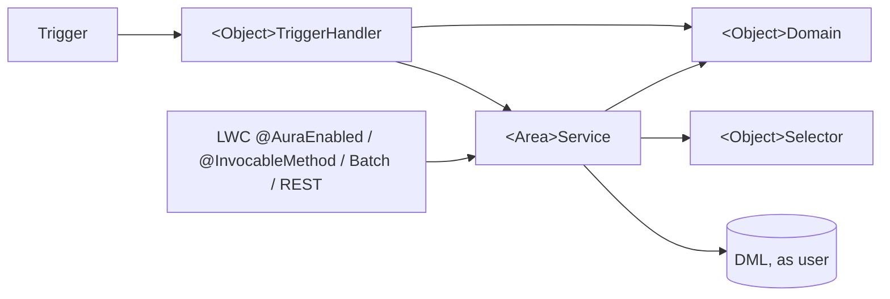

# Apex Standards

## 1. Purpose and scope

These are SOLVD's Apex standards. They apply to **all new Apex** in this org. Existing code moves to them **when it is touched**: if you change a legacy class or trigger, bring the part you change into line, and don't refactor unrelated code in the same PR. Claude's automated PR review and human reviewers check PRs against this document. If this org needs a different rule, change it here, in its own PR, so people and agents read the same thing.

Two decisions anchor everything below:

- **Trigger framework.** Every trigger uses the vendored `TriggerHandler` (from [kevinohara80/sfdc-trigger-framework](https://github.com/kevinohara80/sfdc-trigger-framework), MIT). It is copied into the repo as source, not installed as a package. If the org doesn't have it yet, the `/apex-trigger-scaffold` skill (from the `solvd-salesforce-development` plugin) adds it with its test, and it ships with the first feature that needs it.
- **Light enterprise layering (fflib-style, without the fflib library).** Selectors own queries, Domains own record logic, Services own business processes, and entry points stay thin.

## 2. Layers at a glance



| Layer                                                          | Owns                                                                                                                       | Must not                      |
| -------------------------------------------------------------- | -------------------------------------------------------------------------------------------------------------------------- | ----------------------------- |
| Trigger                                                        | One per object. The body is only `new <Object>TriggerHandler().run();`                                                     | Contain any logic             |
| Handler (`<Object>TriggerHandler extends TriggerHandler`)      | Mapping trigger contexts to domain and service calls                                                                       | Query or run DML directly     |
| Domain (`<Object>Domain`)                                      | Defaults, validation, and derived fields on in-memory records; `newRecord(...)`, the source of truth for creating a record | Query (records are passed in) |
| Service (`<Area>Service`)                                      | Business processes, DML, transaction boundaries, cross-object orchestration                                                | Build SOQL (call a selector)  |
| Selector (`<Object>Selector`)                                  | All SOQL for its object, `WITH USER_MODE` by default                                                                       | Contain business logic        |
| Entry points (controllers, `@AuraEnabled`, `@InvocableMethod`) | Parameter handling and error translation, then one service call                                                            | Hold SOQL or business logic   |

## 3. Worked example (WorkOrder)

This example shows the target shape. The picklist values (`Created`, `Closed`, `Medium`) are illustrative; use the org's real values.

```apex
trigger WorkOrderTrigger on WorkOrder(
  before insert,
  before update,
  before delete,
  after insert,
  after update,
  after delete,
  after undelete
) {
  new WorkOrderTriggerHandler().run();
}
```

```apex
public with sharing class WorkOrderTriggerHandler extends TriggerHandler {
  private final List<WorkOrder> newRecords = (List<WorkOrder>) Trigger.new;
  private final Map<Id, WorkOrder> oldMap = (Map<Id, WorkOrder>) Trigger.oldMap;

  protected override void beforeInsert() {
    new WorkOrderDomain(newRecords).applyDefaults();
  }

  protected override void beforeUpdate() {
    new WorkOrderDomain(newRecords).validateStatusChange(oldMap);
  }
}
```

```apex
public with sharing class WorkOrderDomain {
  private final List<WorkOrder> records;

  public WorkOrderDomain(List<WorkOrder> records) {
    this.records = records;
  }

  /** Single source of truth for a new WorkOrder's required fields and defaults. */
  public static WorkOrder newRecord(Id accountId) {
    return new WorkOrder(AccountId = accountId, Status = 'Created', Priority = 'Medium');
  }

  public void applyDefaults() {
    for (WorkOrder wo : records) {
      if (wo.Priority == null) {
        wo.Priority = 'Medium';
      }
    }
  }

  public void validateStatusChange(Map<Id, WorkOrder> oldMap) {
    for (WorkOrder wo : records) {
      if (oldMap.get(wo.Id).Status == 'Closed' && wo.Status != 'Closed') {
        wo.addError('Closed work orders cannot be reopened.');
      }
    }
  }
}
```

```apex
public inherited sharing class WorkOrderSelector {
  public List<WorkOrder> selectByIds(Set<Id> ids) {
    return [SELECT Id, AccountId, Status, Priority FROM WorkOrder WHERE Id IN :ids WITH USER_MODE];
  }

  public List<WorkOrder> selectOpenByAccountIds(Set<Id> accountIds) {
    return [
      SELECT Id, AccountId, Status, Priority
      FROM WorkOrder
      WHERE AccountId IN :accountIds AND Status != 'Closed'
      WITH USER_MODE
    ];
  }
}
```

```apex
public with sharing class WorkOrderService {
  @TestVisible
  private static WorkOrderSelector selector = new WorkOrderSelector();

  public static List<WorkOrder> createForAccounts(Set<Id> accountIds) {
    List<WorkOrder> toInsert = new List<WorkOrder>();
    for (Id accountId : accountIds) {
      toInsert.add(WorkOrderDomain.newRecord(accountId));
    }
    insert as user toInsert;
    return toInsert;
  }

  public static List<WorkOrder> openWorkOrdersFor(Set<Id> accountIds) {
    return selector.selectOpenByAccountIds(accountIds);
  }
}
```

Using `TriggerHandler`:

- `TriggerHandler.bypass('WorkOrderTriggerHandler')` and `TriggerHandler.clearBypass(...)` skip a handler for a bulk operation, for example a data fix inside a service. Always clear the bypass in a `finally` block.
- `setMaxLoopCount(n)` in a handler's constructor guards against recursion.
- Never call `run()` outside a trigger. It throws `TriggerHandlerException`.

## 4. Test data: Domain defaults plus per-object test builders

There is **no shared `TestDataFactory`**. Record-creation rules live in exactly one place, the Domain's `newRecord(...)`. Each object gets a small `@IsTest` builder that starts from those defaults and adds only test conveniences. Tests therefore build records the same way production code does, and every object has its own small file, which keeps merge conflicts rare.

```apex
@IsTest
public class WorkOrderTestBuilder {
  private final WorkOrder record;

  public WorkOrderTestBuilder(Id accountId) {
    record = WorkOrderDomain.newRecord(accountId);
  }

  public WorkOrderTestBuilder withStatus(String status) {
    record.Status = status;
    return this;
  }

  public WorkOrder build() {
    return record.clone(false, true, false, false);
  }

  public List<WorkOrder> buildMany(Integer count) {
    List<WorkOrder> out = new List<WorkOrder>();
    for (Integer i = 0; i < count; i++) {
      out.add(build());
    }
    return out;
  }

  public WorkOrder insertOne() {
    WorkOrder wo = build();
    insert wo;
    return wo;
  }

  public WorkOrder buildWithFakeId() {
    WorkOrder wo = build();
    wo.Id = TestIds.fake(WorkOrder.SObjectType);
    return wo;
  }
}
```

```apex
@IsTest
public class TestIds {
  private static Integer counter = 1;

  public static Id fake(Schema.SObjectType type) {
    String suffix = String.valueOf(counter++);
    return Id.valueOf(type.getDescribe().getKeyPrefix() + '0'.repeat(12 - suffix.length()) + suffix);
  }
}
```

Rules:

- Builders compose: `new WorkOrderTestBuilder(new AccountTestBuilder().insertOne().Id).withStatus('Closed').insertOne()`.
- Bulk behavior is tested with `buildMany(200)`.
- Use `Assert.areEqual`, `Assert.isTrue` and so on, with a message on every assertion.
- Test classes are `@IsTest private`. Builders and `TestIds` are `@IsTest public` so other tests can use them. Being `@IsTest`, they don't count toward the org's Apex character limit.
- Tests that don't touch the database (domain logic) use `buildWithFakeId()` and skip DML.

## 5. Security

- Every class declares a sharing keyword: `with sharing` by default, and `inherited sharing` for selectors and utilities. `without sharing` needs a comment explaining why, plus reviewer sign-off.
- SOQL uses `WITH USER_MODE`. DML uses `insert as user` / `update as user` (or `Database.*` with `AccessLevel.USER_MODE`). System-mode exceptions, such as integration or platform-event handlers, are documented inline.
- Never build dynamic SOQL from user input without `Database.queryWithBinds`.

## 6. General rules

- Bulkify everything: no SOQL or DML inside loops.
- No hard-coded IDs, URLs, or user names. Use Custom Metadata, Custom Labels, or queries.
- Services throw `<Area>Exception` (a custom exception class). Convert to `AuraHandledException` only at `@AuraEnabled` entry points.
- Add ApexDoc to every public method.
- New classes and triggers use the repo's `sourceApiVersion` (see [`api-version.md`](./api-version.md)).

## 7. Migrating legacy code when touched

Most orgs we work in already have triggers and classes that predate this standard. Don't refactor them for their own sake. When a feature touches one:

- **More than one trigger on an object:** consolidate into one `<Object>Trigger` and one `<Object>TriggerHandler extends TriggerHandler`, keeping the existing logic as private methods in the handler at first. Delete the old triggers in the same PR with a `destructiveChanges.xml` in the feature manifest folder.
- **SOQL in a trigger, controller or service:** move the query you change into the object's `<Object>Selector`, and create the selector if it doesn't exist.
- **Record defaults or validation scattered across classes:** move the part you change into `<Object>Domain`.
- **A `TestDataFactory` or similar:** leave it in place for existing tests. New tests use `<Object>TestBuilder`.

Keep the migration inside the code your feature already changes, and say in the PR what moved.

### Where existing classes map

<!-- Fill this in after the first full retrieve: list the org's existing Apex by the layer it will become when touched
     (trigger handlers, controllers, services, utilities, async). It tells people and agents where new code belongs. -->

| Layer today      | Classes |
| ---------------- | ------- |
| Trigger handlers |         |
| Controllers      |         |
| Services         |         |
| Utilities        |         |
| Async            |         |
